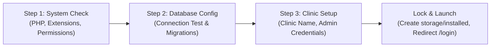

# MediCore Clinic — Commercial Installation & Deployment Guide

**Target Deployment Model:** Self-Hosted On-Premise / Private Cloud / cPanel / Shared Hosting  
**Installation Methods:** Web GUI Installation Wizard (`/install`) OR Automated CLI Script  
**Verification Suite:** `Tests\Feature\InstallationWizardTest` (3 tests passing)  

---

## 1. System Requirements

Before installing MediCore Clinic, ensure the hosting environment meets the following specifications:

| Component | Minimum Specification | Recommended Specification |
| :--- | :--- | :--- |
| **PHP Version** | PHP 8.2 or 8.3 | PHP 8.3 |
| **Database** | MySQL 8.0, MariaDB 10.5+, or SQLite 3.35+ | MySQL 8.0 (InnoDB) |
| **Web Server** | Apache 2.4+ (mod_rewrite) or Nginx 1.20+ | Nginx 1.24+ |
| **RAM** | 1 GB RAM (Single Doctor Practice) | 4 GB+ RAM (Multi-Branch Clinic) |
| **Disk Space** | 500 MB for application + space for EMR documents | 20 GB+ SSD |
| **Required PHP Extensions** | `bcmath`, `ctype`, `curl`, `dom`, `fileinfo`, `gd`, `intl`, `json`, `mbstring`, `openssl`, `pcre`, `pdo`, `pdo_mysql`, `pdo_sqlite`, `tokenizer`, `xml`, `zip` |

---

## 2. Web GUI Installation Wizard (`/install`)

MediCore Clinic includes a commercial 3-step installation wizard designed for non-technical clinic administrators and deployment engineers:



### Step 1: Server Requirements & Directory Permissions
The wizard verifies:
- PHP version $\ge 8.2$.
- All required PHP extensions installed and active.
- Write permissions on `storage/`, `storage/app/backups`, `storage/framework/`, `storage/logs`, and `bootstrap/cache/`.

### Step 2: Database Configuration & Connection Test
- Supports both **MySQL** and **SQLite**.
- Includes live "Test Connection" button (`POST /install/test-db`) that validates credentials and database write privileges before executing migrations.
- Automatically executes 15 schema migrations and seeds default specialty parameters and ICD-10 catalogs.

### Step 3: Clinic Profile & Master Administrator Creation
- Clinic Name, Contact Phone, Official Email, Physical Address, Default Currency (e.g., USD, EUR, MAD, SAR, AED).
- Master Super-Administrator account creation (Name, Email, Secure Password).

### Step 4: Security Lockdown
- Upon successful setup, the wizard creates the permanent deployment lock file: `storage/installed`.
- The `EnsureInstalled` middleware immediately locks the wizard; any subsequent attempts to visit `/install` redirect to the authenticated login portal.

---

## 3. Production Deployment Guides

### Option A: Standard Linux VPS Deployment (Ubuntu 22.04 / 24.04 LTS + Nginx)

#### 1. Server Packages Setup
```bash
sudo apt update && sudo apt upgrade -y
sudo apt install -y nginx mysql-server php8.3-fpm php8.3-mysql php8.3-sqlite3 php8.3-mbstring \
    php8.3-xml php8.3-bcmath php8.3-curl php8.3-zip php8.3-gd php8.3-intl unzip git
```

#### 2. Source Code Deployment
```bash
sudo mkdir -p /var/www/medicore
sudo cp -r . /var/www/medicore/
cd /var/www/medicore

sudo chown -R www-data:www-data /var/www/medicore
sudo chmod -R 755 /var/www/medicore
sudo chmod -R 775 /var/www/medicore/storage /var/www/medicore/bootstrap/cache
```

#### 3. Nginx Virtual Host Configuration
Create `/etc/nginx/sites-available/medicore`:
```nginx
server {
    listen 80;
    server_name clinic.yourdomain.com;
    root /var/www/medicore/public;

    add_header X-Frame-Options "SAMEORIGIN";
    add_header X-Content-Type-Options "nosniff";
    add_header X-XSS-Protection "1; mode=block";

    index index.php index.html;
    charset utf-8;

    location / {
        try_files $uri $uri/ /index.php?$query_string;
    }

    location = /favicon.ico { access_log off; log_not_found off; }
    location = /robots.txt  { access_log off; log_not_found off; }

    error_page 404 /index.php;

    location ~ \.php$ {
        fastcgi_pass unix:/var/run/php/php8.3-fpm.sock;
        fastcgi_param SCRIPT_FILENAME $realpath_root$fastcgi_script_name;
        include fastcgi_params;
        fastcgi_hide_header X-Powered-By;
    }

    location ~ /\.(?!well-known).* {
        deny all;
    }
}
```
Enable site and restart Nginx:
```bash
sudo ln -s /etc/nginx/sites-available/medicore /etc/nginx/sites-enabled/
sudo nginx -t && sudo systemctl reload nginx
```

---

### Option B: cPanel / Shared Hosting Deployment

1. **Upload Files:** Upload the application files to the root directory outside `public_html` (e.g., `/home/username/medicore`).
2. **Document Root Mapping:** Point your primary domain or subdomain Document Root to `/home/username/medicore/public`.
3. **Database Setup in cPanel:**
   - Create a MySQL Database via cPanel Database Wizard (e.g., `cpaneluser_medicore`).
   - Create a MySQL User and assign full permissions to the database.
4. **Environment Setup:**
   - Copy `.env.example` to `.env`.
   - Set `APP_ENV=production`, `APP_DEBUG=false`, `APP_URL=https://yourdomain.com`.
   - Set MySQL database credentials in `.env`.
   - Run `php artisan key:generate`.
5. **Run Migrations:** Open cPanel Terminal or run via SSH:
   ```bash
   php artisan migrate --force --seed
   touch storage/installed
   ```

---

## 4. Maintenance & Background Operations

### Scheduled Clinic Cron Tasks
Configure the server cron job to execute Laravel's scheduler once every minute:
```bash
* * * * * cd /var/www/medicore && php artisan schedule:run >> /dev/null 2>&1
```
The scheduler handles:
- Daily appointment reminders.
- Nightly automated database backups.
- Queue cleanups and temporary cache purges.

### Queue Worker (Optional for high-volume clinics)
To process asynchronous laboratory results and email notifications, configure Supervisor:
```ini
[program:medicore-worker]
process_name=%(program_name)s_%(process_num)02d
command=php /var/www/medicore/artisan queue:work --sleep=3 --tries=3 --max-time=3600
autostart=true
autorestart=true
user=www-data
numprocs=2
redirect_stderr=true
stdout_logfile=/var/www/medicore/storage/logs/worker.log
```
