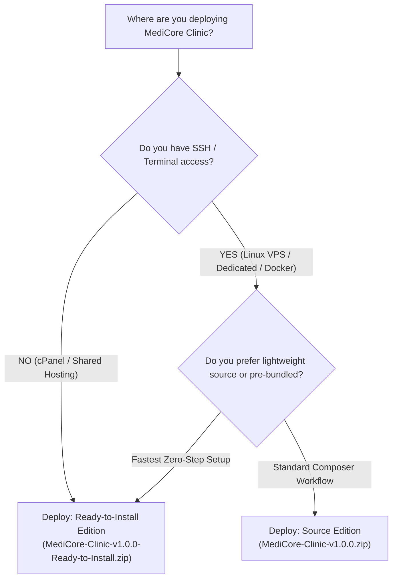

# MediCore Clinic — Distribution Editions Comparison Guide

MediCore Clinic Management System v1.0.0 is released in two specialized commercial distribution editions to cater to different hosting environments, technical preferences, and deployment workflows.

Both editions grant **100% full unencrypted source code ownership**, identical clinical features, and perpetual single-clinic usage rights.

---

## 1. Quick Comparison Matrix

| Commercial Feature | Source Edition (Developer Standard) | Ready-to-Install Edition (Plug & Play) |
| :--- | :--- | :--- |
| **Primary Audience** | Software Developers, DevOps Engineers, IT Teams | Clinic Owners, Practice Managers, Non-Technical Buyers |
| **Target Hosting** | Linux VPS (Ubuntu/Debian), Dedicated Server, Docker | cPanel, Plesk, CloudLinux, Shared Hosting |
| **ZIP File Name** | `MediCore-Clinic-v1.0.0.zip` | `MediCore-Clinic-v1.0.0-Ready-to-Install.zip` |
| **Compressed Size** | **685 KB** (~0.67 MB) | **8.2 MB** (~8.20 MB) |
| **Uncompressed Size** | **3.2 MB** (Clean core source) | **28.38 MB** (Source + Production Vendor) |
| **Total File Count** | **239 files** | **6,604 files** |
| **`vendor/` Directory** | Omitted (Install via Composer) | **Pre-Installed** (Production-only packages) |
| **`public/build/` Assets** | **Pre-Compiled** (No Node/npm needed) | **Pre-Compiled** (No Node/npm needed) |
| **SSH / Terminal Required?** | **Yes** (To run `composer install`) | **NO** (Zero Terminal / Zero CLI required) |
| **Composer Required?** | **Yes** (PHP Composer 2.x) | **NO** (All dependencies bundled) |
| **Node.js / npm Required?**| **NO** (Unless recompiling custom React) | **NO** (Unless recompiling custom React) |
| **Installation Method** | Web Wizard (`/install`) OR Command Line | Web Wizard (`/install`) via Web Browser |
| **Source Code Access** | 100% Full Unencrypted PHP + React/TS | 100% Full Unencrypted PHP + React/TS |
| **Multi-Specialty EMR** | Dental, Eye, Derm, Peds, Physio, Forms | Dental, Eye, Derm, Peds, Physio, Forms |
| **Licensing Rights** | Perpetual Single-Clinic Self-Hosted | Perpetual Single-Clinic Self-Hosted |

---

## 2. In-Depth Technical Breakdown

### Edition A: Source Edition (`MediCore-Clinic-v1.0.0.zip`)
- **Philosophy:** Clean, ultra-lightweight source archive designed for standard software engineering workflows, Git-based continuous deployment pipelines, and customized enterprise installations.
- **How It Works:**
  - Contains all backend PHP classes, models, controllers, React 19 pages, and database migrations.
  - Excludes the `vendor/` directory to minimize archive weight (download size is only 670 KB).
  - The buyer uploads the archive to a Linux server or development workstation, and runs:
    ```bash
    composer install --no-dev --optimize-autoloader
    ```
  - Ideal for developers who want full control over their PHP environment and package caching.

---

### Edition B: Ready-to-Install Edition (`MediCore-Clinic-v1.0.0-Ready-to-Install.zip`)
- **Philosophy:** Plug-and-play convenience for healthcare professionals, clinic managers, and buyers using shared cPanel hosting where command-line tools are restricted or unavailable.
- **How It Works:**
  - Bundles the complete, production-hardened `vendor/` directory (79 production PHP packages) pre-installed and optimized.
  - The buyer does **NOT** need SSH, Terminal, Composer, or Node.js.
  - The buyer uploads the ZIP file through cPanel File Manager, extracts it, maps their domain to `/public`, and opens `/install` in their web browser.
  - All database tables, initial configurations, and administrative accounts are created directly through the intuitive Web Installation Wizard.

---

## 3. Decision Guide: Which Edition Should You Deploy?



1. **Choose Ready-to-Install Edition IF:**
   - You are hosting on standard **cPanel**, **Plesk**, or **Shared Hosting**.
   - Your hosting account does not include SSH or Terminal access.
   - You want to complete the entire setup using your web browser in under 5 minutes.
   - You do not want to install Composer on your workstation or server.

2. **Choose Source Edition IF:**
   - You are deploying to a **Linux VPS (Ubuntu, Debian, AlmaLinux)** or **Cloud Server**.
   - You are using **Docker**, **Kubernetes**, or automated CI/CD pipelines.
   - You are a developer customizing composer packages or extending internal domain libraries.
   - You prefer an ultra-fast download under 1 MB.

---

## 4. Guarantee of Architectural Parity

Regardless of which edition you choose:
- Both editions execute the identical Laravel 12 backend and React 19 frontend.
- Both editions include the complete Dental Odontogram, Ophthalmology Refraction, EMR, Billing, and Backup features.
- Both editions include the complete suite of 8 professional English documentation manuals.
- Both editions provide 100% unencrypted source code with perpetual ownership rights.
