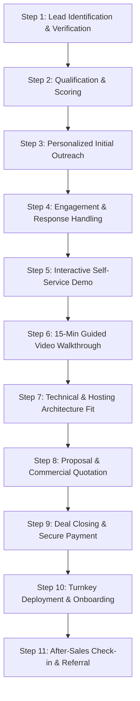

# MediCore Clinic v1.0.0 — 11-Step B2B Healthcare Sales Pipeline & Execution Manual

**Document Reference:** `MC-SALES-PROC-2026-v11`  
**Author:** Commercial Operations & Revenue Leadership  
**Target Sectors:** Dental Clinics, Ophthalmology Practices, Multi-Specialty Medical Polyclinics  
**Applicable Markets:** Morocco (MAD) & European Union (EUR)  
**Status:** Approved Standard Operating Procedure  
**Version:** `1.0.0`  

---

## 1. Pipeline Overview & Commercial Methodology

Healthcare sales require a consultative, high-integrity approach. Doctors, medical directors, and practice managers are highly risk-averse, protective of their clinical time, and legally bound to preserve patient privacy.

The MediCore B2B sales pipeline is structured as an **11-step consultative lifecycle** designed to convert cold practitioner prospects into high-satisfaction, long-term clinic clients with minimal friction and maximum transparency.



---

## 2. The 11-Step B2B Healthcare Sales Pipeline

### Step 1: Lead Identification & Verification
- **Source:** Public dental registers, medical boards, verified clinic websites, and Google Business profiles (e.g., recorded in `MediCore_International_Clinic_Leads.xlsx`).
- **Data Verification:** Confirm that the clinic is actively operating, identify the clinic specialty (General, Dental, Ophthalmology, Polyclinic), and identify the lead doctor or practice manager.
- **Enrichment:** Record clinic website URL, public phone/WhatsApp, and public business email.

### Step 2: Qualification & Account Scoring
Assign an account score (1–10) based on three criteria:
1. **Clinical Match:** Multi-chair dental clinics, busy ophthalmology clinics, and polyclinics score 10/10 because MediCore's specialized modules (FDI chart, eye refractions, queue TV display) deliver immediate operational ROI.
2. **Current System Friction:** Clinics burdened by rising SaaS fees (Doctolib, Weda, Gesden) or struggling with obsolete desktop systems score highest.
3. **Decision Maker Accessibility:** Solo practices where the lead physician directly manages purchasing decisions convert 3x faster than multi-stakeholder hospital networks.

### Step 3: Personalized Initial Outreach
- **Channel Selection:**
  - *Morocco:* Email + WhatsApp Business message to clinic coordinator.
  - *France, Belgium, Spain, Portugal, Netherlands:* Highly tailored cold email to professional clinic address.
  - *Germany:* LinkedIn connection request followed by practice manager inquiry.
- **Template Execution:** Select the exact market-specific template from `MEDICORE_SALES_OUTREACH_TEMPLATES.md`.
- **Tone:** Dignified, professional, focused on data sovereignty and zero recurring subscription fees.

### Step 4: Engagement & Response Handling
Classify every incoming response within **2 hours**:
- **Hot (Wants a demo / price inquiry):** Fast-track directly to Step 5 & Step 6.
- **Information Request ("Send more details"):** Respond with the 1-page feature PDF summary and instant demo credentials.
- **Objection (Price, time, existing software):** Deploy the Healthcare Objections Handling Matrix (Section 3).
- **Opt-Out ("STOP" / "Pas intéressé"):** Immediately mark "Opted Out" in the tracker and suppress within 24 hours.

### Step 5: Interactive Self-Service Live Demo Delivery
- Provide instant access to the pre-configured live demonstration environment:
  - URL: `https://demo.medicore-clinic.com`
  - Pre-seeded test accounts: Doctor (`doctor@medicore.local`), Receptionist (`receptionist@medicore.local`).
- **Behavioral Guidance:** Direct the dentist to the **Dental Charting tab** (32 teeth interactive visualizer); direct the eye specialist to the **Ophthalmology Consultation tab**; direct the clinic manager to the **Waiting Room Queue Display**.

### Step 6: 15-Minute Tailored Video Screen-Share / Walkthrough
For qualified clinics requesting a guided walkthrough (via Google Meet, Zoom, or AnyDesk):
- **Minute 0–3: Discovery:** Ask: *"How does your team currently manage patient flow from reception to consultation?"*
- **Minute 4–10: Clinical Feature Highlight:** Walk through live appointment creation, waiting room queue transition, and one-click PDF prescription generation.
- **Minute 11–15: ROI & Commercial Close:** Contrast their current annual software bill with MediCore's one-time license fee.

### Step 7: Technical & Hosting Architecture Fit
Evaluate the clinic's preferred infrastructure:
- **Option A (Local Clinic Server / Air-Gapped LAN):** Ideal for clinics prioritizing 100% offline security with zero internet dependency. Installed on any local mini-PC or Windows/Linux office machine.
- **Option B (Private cPanel / Shared Hosting):** Best for small practices with an existing clinic website domain (Nindohost, Genious, Hostinger).
- **Option C (Dedicated Sovereign Cloud VPS):** Recommended for multi-branch clinics requiring secure remote access via Hetzner (Germany/Finland) or OVHcloud (France).

### Step 8: Commercial Proposal & License Agreement Presentation
- Deliver an itemized formal quotation using the pricing structure from `FINAL_MEDICORE_PRICING_STRATEGY.md`:
  - **License Tier:** Solo (990 MAD / €99) or Polyclinic (1,990 MAD / €199).
  - **Optional Setup Service:** Remote turnkey deployment (+400 MAD / +€49).
  - **Payment Terms:** 100% upon order confirmation; immediate delivery of commercial ZIP package and installation wizard.
- Attach the standard `LICENSE_AGREEMENT.md` guaranteeing permanent usage rights and unencrypted source code.

### Step 9: Deal Closing & Secure Payment Processing
- Provide seamless, localized checkout options:
  - *Morocco:* Official corporate Bank Wire (RIB BMCE / Attijariwafa / CIH), CMI card, or Cash Plus.
  - *Europe:* Stripe Checkout, SEPA Instant Bank Wire (IBAN/BIC), iDEAL, Bancontact, or PayPal.
- Issue formal commercial tax invoice immediately upon payment verification.

### Step 10: Turnkey Deployment & Technical Onboarding
- **Delivery:** Provide secure download link for `MediCore-Clinic-v1.0.0-Ready-to-Install.zip`.
- **Installation Execution:**
  - If self-installed by clinic IT: Point to the built-in 5-step Web Wizard (`/install`).
  - If Turnkey Setup purchased: Sales technician schedules a 30-minute AnyDesk/SSH session to configure database, SSL certificate, cron task, and initial doctor accounts.
- **Verification:** Execute the post-installation health check and deliver admin credentials to the clinic director.

### Step 11: After-Sales Check-in, Reviews & Referral Generation
- **Day 7:** Operational check-in with the clinic receptionist: *"How smoothly did the queue display run this week?"*
- **Day 30:** Senior management check-in with the lead doctor:
  - Request a short written or video testimonial for the MediCore commercial showcase.
  - Offer a **25% referral reward** (or free feature customization) for every neighboring clinic they introduce.

---

## 3. Healthcare Objections Handling Matrix

| Common Clinic Objection | Underlying Concern | Proven MediCore Response Strategy |
| :--- | :--- | :--- |
| **"We already use Doctolib / Weda / Gesden / Clinosys."** | Switching friction & perceived inertia. | *"We completely understand, Doctor. Many of our current clients also used those platforms. The difference is financial and legal sovereignty: Doctolib costs your practice over €1,600 every year, and if you stop paying, you lose access to your workflow. With MediCore, you pay €99 once and own your system for life. Furthermore, some clinics keep Doctolib purely for patient online booking while using MediCore internally for confidential clinical records, reducing their tier costs."* |
| **"Who is going to install and maintain this for us? We have no IT staff."** | Fear of technical complexity. | *"MediCore includes an automated 5-step Web Installation Wizard that requires zero coding. Even better, our team offers a complete Turnkey Remote Setup for just 400 MAD / €49: we configure the database, setup SSL security, create your doctor accounts, and test the entire system in under 45 minutes."* |
| **"Is our patient health data safe? What about GDPR / CNDP?"** | Compliance liability & privacy breaches. | *"With typical cloud software, your patient data sits on shared third-party servers outside your direct control. MediCore is 100% self-hosted: the software and database reside exclusively on your clinic's local server or your private cloud. No external party—not even MediCore—can access your patient records. You maintain 100% compliance with GDPR and Moroccan CNDP Law 09-08."* |
| **"Can we import our existing patient records from our old software?"** | Dread of losing historical records or manual re-typing. | *"Yes. MediCore supports standard patient data imports from CSV and Excel spreadsheets. We also provide a dedicated migration service to transfer your patient names, contact numbers, and basic histories directly into your new MediCore database."* |
| **"What happens if there is a software bug or we need future updates?"** | Fear of vendor obsolescence. | *"Your license includes 6 to 12 months of official security patches and software updates. Even more importantly, MediCore delivers 100% unencrypted source code (Laravel 11 / React 18). Unlike proprietary black-box software that traps you if the vendor disappears, you have permanent, unrestricted ownership of your code forever."* |

---

## 4. Key Performance Indicators (KPIs) & Target Conversion Funnel

```
+----------------------------------------------------------------------------------------------------+
| STAGE                  | BENCHMARK CONVERSION RATE | TARGET VOLUME (PER 200 MONTHLY OUTREACHES)    |
+----------------------------------------------------------------------------------------------------+
| 1. Verified Outreach   | 100% (Delivery Rate >98%) | 200 Targeted Clinics Contacted                |
| 2. Positive Response   | 8% – 12%                  | 16 – 24 Qualified Conversations Started        |
| 3. Live Demo Explored  | 60% of engaged prospects  | 10 – 15 Clinics Actively Testing Demo          |
| 4. Formal Quotation    | 70% of demo testers       | 7 – 10 Formal Quotations Issued                |
| 5. Closed Won Deal     | 50% of quoted prospects   | 4 – 5 New Paying Clinics per 200 Outreach reps |
+----------------------------------------------------------------------------------------------------+
```

### Financial Model at Target Conversion:
- **Acquisitions per rep/month:** ~5 clinics (3 Solo @ 990 MAD / €99 + 2 Polyclinics @ 1,990 MAD / €199 + 3 Setup Services).
- **Average Revenue per Rep/Month:** ~€950 – €1,200.
- **Customer Acquisition Cost (CAC):** Under **€35 per paying clinic** (predominantly time and hosting infrastructure).
- **Payback Period:** Instantaneous (Cash collected on Day 1 prior to license package delivery).
